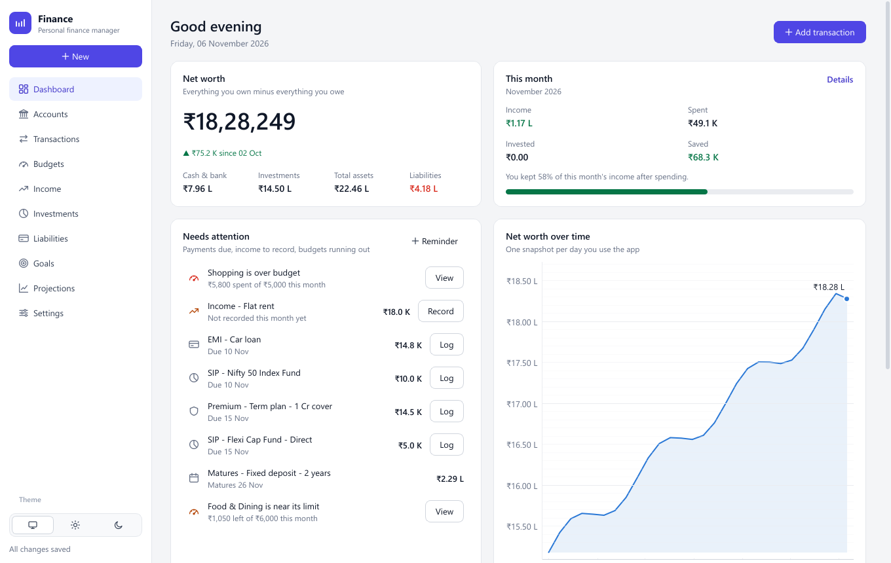
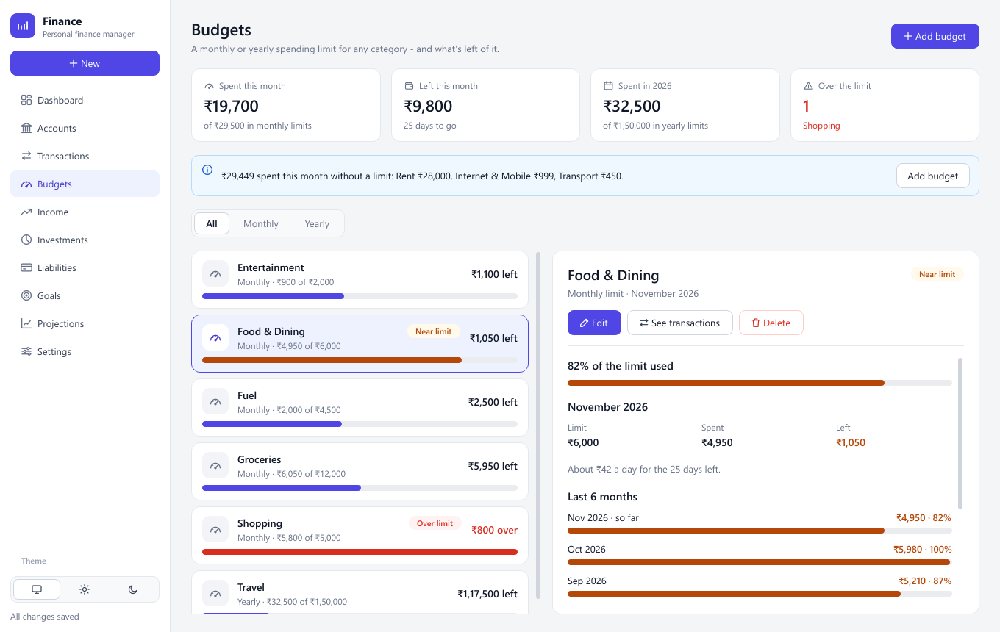

# Personal Finance Manager

A private, offline desktop app for your money in rupees: accounts, spending,
budgets, income, investments, loans, goals and long-range projections. There is
no server, no sign-up and no network access. Your data stays on your computer as
plain JSON files you can read in any text editor, now or in twenty years.



**[User guide](docs/user-guide/README.md)** · [Changelog](CHANGELOG.md) ·
[MIT license](LICENSE)

> The screenshots show a fictional household generated by `tools/make_demo_store.py`.

## Features

- **Dashboard** shows your net worth and how it's moving, and this month's income,
  spending and savings rate. Its *Needs attention* list holds EMIs, SIPs and
  premiums that are due, income not yet recorded, maturing deposits, your
  reminders, and budgets that are running out. You can log any of them in one
  click.
- **Accounts** keep balances that always equal their transactions. *Update
  balance* records the difference as an adjustment, so history stays correct.
- **Transactions** start with the type (expense, income, transfer or
  investment), then show only the fields that matter. You can filter by period,
  type, account and category, search, duplicate, and use right-click actions.
- **Budgets** set a monthly or yearly limit per spending category, following the
  calendar or the financial year. They suggest a limit from your recent spending,
  show how much you can still spend each day, and warn you while you type an
  expense.
- **Income** handles a salary breakdown (basic, HRA, PF, professional tax, TDS)
  and works out take-home pay. It keeps a month-by-month record of what actually
  arrived.
- **Investments** cover mutual funds and SIPs, stocks, FDs, PPF, EPF, NPS, gold and
  bonds. They show allocation and an annual return (XIRR) that accounts for
  timing. Term insurance is kept separate as *protection*.
- **Liabilities** cover loans and card dues, with one-click EMI logging, the
  interest still to pay, and when you'll be debt-free.
- **Goals and projections** show the monthly amount each goal needs. Projections
  give net worth year by year, retirement drawdown, the age your money would run
  out, and a stress test.
- **Light and dark themes**, or *Match Windows*. Amounts use Indian grouping
  (₹1,23,45,678).



## Install and run

**Windows.** Install [Python 3.10+](https://www.python.org/downloads/) and tick
*Add python.exe to PATH*. Then, in this folder:

```bat
run_setup.bat      :: once: creates .venv and installs the requirements
run.bat            :: starts the app
run_build_exe.bat  :: optional: builds dist\PersonalFinanceManager\PersonalFinanceManager.exe
```

**macOS / Linux.** The app is developed and tested on Windows, but it is plain
Python and PyQt6:

```bash
python3 -m venv .venv && . .venv/bin/activate
pip install -r requirements.txt
python main.py
```

**Try it with sample data first.** This opens a fictional household without
touching your own data:

```bat
.venv\Scripts\python tools\make_demo_store.py %TEMP%\pfm-demo
set PFM_HOME=%TEMP%\pfm-demo
run.bat
```

That console keeps opening the demo. A new console window opens your own data
again.

New to the app? The **[user guide](docs/user-guide/README.md)** walks through every
page.

## Your data

| Running | Data folder |
|---------|-------------|
| From source (`run.bat`) | `data\` beside `main.py` |
| The built `.exe` | `%APPDATA%\PersonalFinanceManager\data\` |
| Either, with `PFM_HOME` set | `%PFM_HOME%\data\` |

```
data/store/*.json            your records - one plain JSON file per table
data/store/_meta.json        format version + a short description of the files
data/user/backups/           automatic backups
data/user/preferences.json   theme, budget year, projection assumptions
```

- **Safe saves.** Every change is saved within a second. Each file is written to a
  temporary copy and then swapped in, so a crash can't leave half a file.
- **Fails safe.** If a data file is damaged, the app refuses to start rather than
  overwrite it, and tells you which file and where the newest backup is. Only one
  copy of the app can run at a time.
- **Backups.** A copy is taken whenever the app opens and closes. The latest 30 are
  always kept, then one per day for a month, one per month for two years, and one
  per year forever. An optional second copy can go to a cloud-synced folder.
- **Audit.** `python docs/skills/data-hygiene/check_store.py` checks your data and
  changes nothing.
- **Private.** Nothing leaves your computer. `.gitignore` keeps `data/store/`,
  `data/user/` and `logs/` out of this repository.

## Development

```
ui  ──►  services  ──►  repositories  ──►  db (SQLite, in memory)
              └─►  models                     ▲
                                              │
          services/storage.py ────────────────┘   reads / writes data/store/*.json
```

- `data/store/*.json` is the source of truth. SQLite is a scratch working copy,
  rebuilt in memory from the files at every launch.
- The store format is versioned. `services/store_migrations.py` upgrades older
  stores, after a backup, the first time a new version opens them.
- The UI only talks to services, never to the database.
- Themes are colour tokens (`ui/theme/tokens.py`) applied through one stylesheet
  template. No view has a hard-coded colour.

```bat
run_tests.bat                                :: 169 tests, including end-to-end runs of the real window
.venv\Scripts\python tools\render_pages.py   :: every page, both themes, on a temporary COPY of your data
.venv\Scripts\python tools\make_user_guide.py :: regenerate the guide's screenshots from demo data
.venv\Scripts\python tools\privacy_scan.py   :: before pushing: is any of your data in the repo?
```

| Doc | For |
|-----|-----|
| [`CLAUDE.md`](CLAUDE.md) | Architecture, conventions and gotchas: read it before changing code |
| [`STATUS.md`](STATUS.md) | Current state, what was verified, and the open gaps |
| [`docs/skills/`](docs/skills/) | Playbooks: add an entity or a page, budgets, verify a change, audit data, update the guide, release |
| [`CHANGELOG.md`](CHANGELOG.md) | What changed in each version |

Contributions are welcome. Run the tests, keep the layering rule (`ui/` never
imports `db/` or `repositories/`), and never commit real financial data: use
`tools/make_demo_store.py` for examples and screenshots.

## License

[MIT](LICENSE). Use it, change it, share it.
