# User guide

Personal Finance Manager is a private desktop app for your money in rupees:
bank accounts, spending, budgets, income, investments, loans, goals and
long-term projections. It works offline, has no sign-up, and keeps everything
on your computer as plain files you can read in 20 years.

> Every screenshot shows a **made-up household** (built by
> `tools/make_demo_store.py`), not anyone's real money.

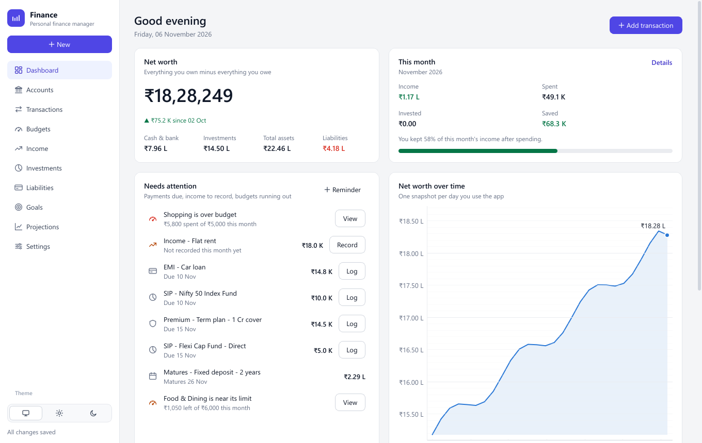

## Contents

1. [Getting started](#1-getting-started)
2. [Finding your way around](#2-finding-your-way-around)
3. [Dashboard](#3-dashboard)
4. [Accounts](#4-accounts)
5. [Transactions](#5-transactions)
6. [Budgets](#6-budgets)
7. [Income](#7-income)
8. [Investments](#8-investments)
9. [Liabilities](#9-liabilities)
10. [Goals](#10-goals)
11. [Projections](#11-projections)
12. [Settings](#12-settings)
13. [Your data and backups](#13-your-data-and-backups)
14. [Keyboard shortcuts](#14-keyboard-shortcuts)
15. [When something looks wrong](#15-when-something-looks-wrong)

---

## 1. Getting started

### Install

**Windows (recommended).** Install [Python 3.10 or newer](https://www.python.org/downloads/)
and tick *Add python.exe to PATH* in the installer. Then, in the app's folder:

| Double-click | What it does |
|--------------|--------------|
| `run_setup.bat` | Once: creates a private Python environment (`.venv`) and installs what the app needs |
| `run.bat` | Opens the app |
| `run_build_exe.bat` | Optional: builds a standalone `PersonalFinanceManager.exe` in `dist\PersonalFinanceManager\` that runs without Python |

**macOS / Linux.** The app is developed and tested on Windows, but it is plain
Python and PyQt6, so this should work:

```bash
python3 -m venv .venv && . .venv/bin/activate
pip install -r requirements.txt
python main.py
```

### Your first ten minutes

1. **Add your accounts.** *Accounts → Add account*: a name, the type (savings,
   salary, cash, wallet, credit card) and what it holds today. That amount is
   recorded as the account's opening balance.
2. **Add your income.** *Income → Add income source*: salary (with its
   breakdown, if you like), rent, freelance work and so on.
3. **Add what you own and owe.** *Investments* for funds, FDs, PPF, gold and
   stocks; *Liabilities* for loans and card dues.
4. **Log your spending as it happens.** Press **Ctrl+N** on any page.
5. **Set a few budgets.** *Budgets → Add budget*. The app suggests a limit
   from what you have actually been spending.

From then on, open the app, look at the Dashboard, and deal with whatever is
under *Needs attention*.

## 2. Finding your way around

- **Sidebar.** Every page, in the same order as the shortcuts Ctrl+1 to Ctrl+0.
- **New.** The button at the top of the sidebar adds anything from anywhere: an
  expense, income, a transfer, an investment purchase, an account, an
  investment, a loan, a goal, a budget, an income source or a reminder.
- **Theme.** The three buttons at the bottom of the sidebar switch between
  *Match Windows*, *Light* and *Dark*.
- **Saving.** There is no Save button for your data. Every change is saved
  within about a second, and the sidebar says *All changes saved*.
- **List pages** (Accounts, Budgets, Income, Investments, Liabilities, Goals)
  share one layout: the list on the left, and on the right the details of the
  selected item with its actions. Double-click an item to edit it.

## 3. Dashboard

The first page answers, in order: what am I worth, how is this month going,
and what needs doing.

- **Net worth.** Everything you own minus everything you owe, and how it moved
  over the last month.
- **This month.** Income, spending, investing, and how much of your income you
  kept.
- **Needs attention.** EMIs, SIPs and insurance premiums due in the next two
  weeks, income you haven't recorded this month, deposits about to mature,
  your reminders, and budgets that are over or close to their limit.
  - **Log** records a payment in one step and updates the loan or investment
    it belongs to.
  - **Record** records this month's income.
  - **View** opens the budget.
- **Net worth over time.** One point for each day you open the app.
- Scroll down for where your money is invested, your goals and your latest
  transactions.

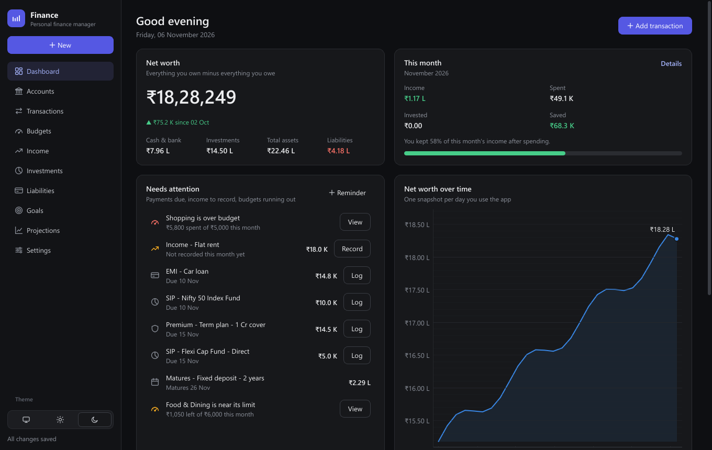

## 4. Accounts

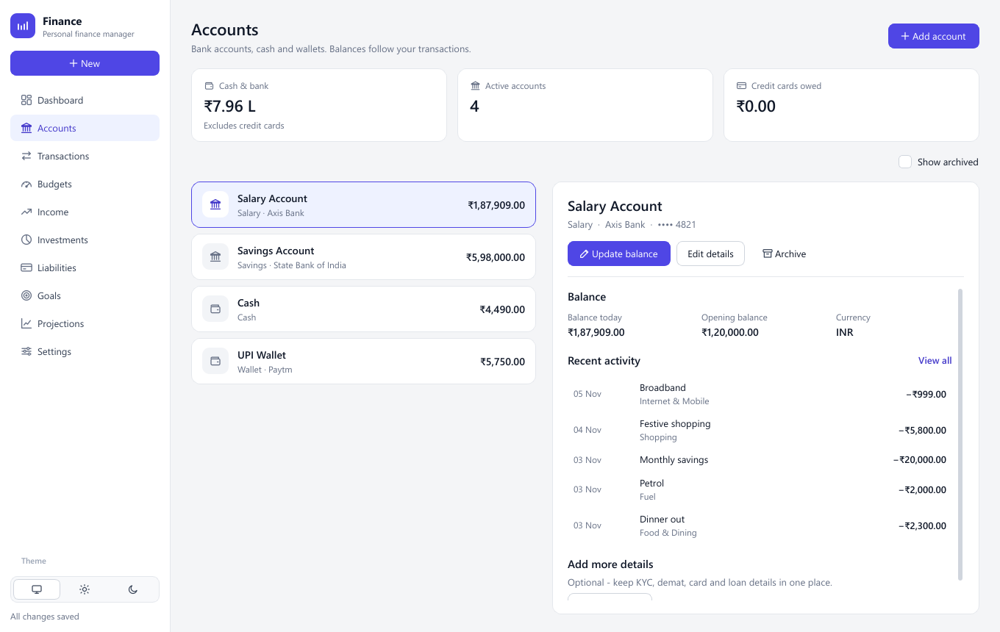

Bank accounts, cash and wallets. A balance always equals the sum of the
account's transactions, so your history stays consistent.

- **Update balance.** Type what the account actually holds today. The
  difference is saved as a *balance adjustment*, which is never counted as
  income or spending.

  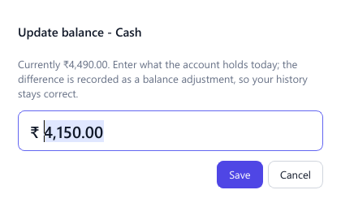

- **Edit details.** Name and type, plus optional KYC, demat, card and loan
  details (*Add more details* lists what you can add).
- **Archive.** Hides an account you've closed. Nothing is deleted, and
  *Show archived* brings it back.
- **Reconcile.** If an account's balance and its transactions ever disagree,
  for example after editing a data file by hand, a banner offers to record the
  difference.
- Credit card *accounts* are not counted as cash. Put what you owe on a card in
  **Liabilities** so it is subtracted from your net worth.

## 5. Transactions

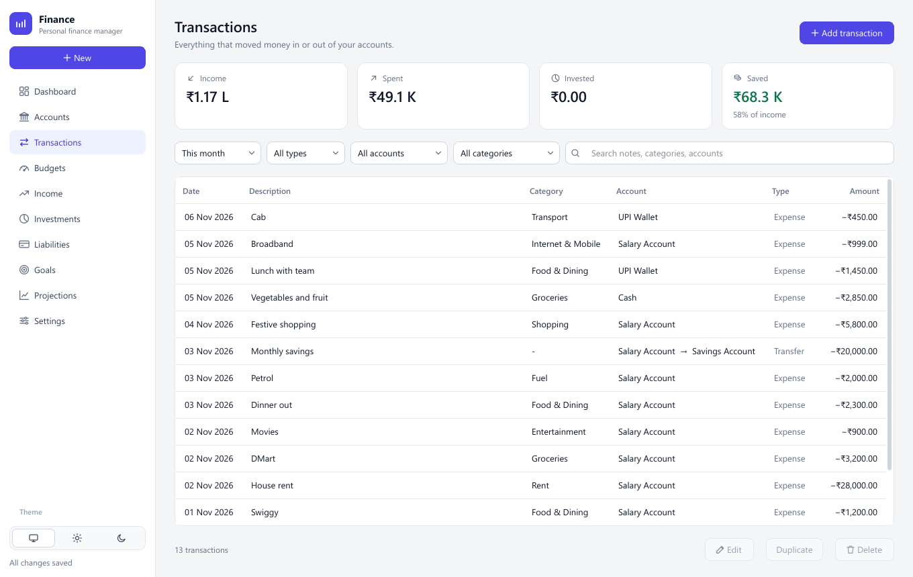

Every movement of money: expenses, income, transfers between your own
accounts, and investment purchases or withdrawals.

- **Add transaction** (or **Ctrl+N**). Pick the type first (*Expense*,
  *Income*, *Transfer* or *Investment*) and only the fields that matter appear.
  *Save & add another* keeps the form open for the next one.
- **Budget hint.** When an expense's category has a budget, the form shows
  what is left of it, and what would be left after this expense, before you
  save. It turns orange when you are close to the limit and red when you would
  go over.

  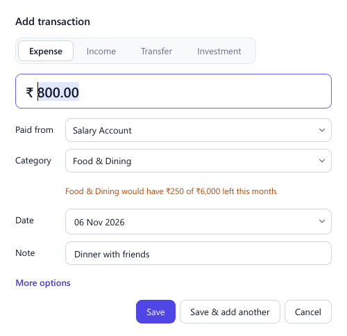

- **Find things.** Choose a period (this month, last month, last 3 months,
  this year, last year, all time), a type, an account or a category, or search
  notes, categories and account names.
- **Change things.** Double-click a row or press **Enter** to edit it, press
  **Delete** to delete it, or right-click it. *Duplicate* copies a transaction
  to today, which is handy for repeat purchases.
- Transfers and balance adjustments are never counted as income or spending.

## 6. Budgets

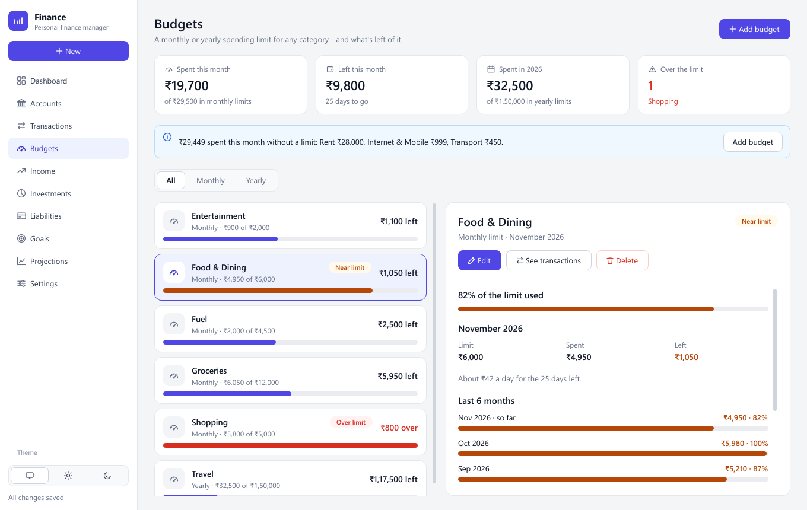

A budget is a spending limit for one category, **every month** or **every
year**. Use monthly limits for everyday spending (groceries, eating out, fuel)
and yearly limits for spending that comes in lumps (travel, school fees,
gifts).

### Set a budget

*Budgets → Add budget* (or *New → Budget*), then choose:

- the **category**,
- **Every month** or **Every year**,
- the **limit**.

The form tells you what you have been spending in that category recently. Click
**Use ₹…** to start from that figure.

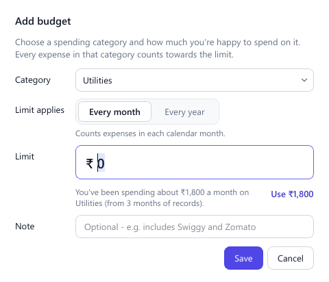

A category can have one monthly and one yearly limit. Adding a limit that
already exists replaces it, and the form warns you first.

### Read the page

- **Each budget** shows what you've spent of the limit, with a bar. The bar
  turns orange and says **Near limit** from 80%, and red with **Over limit**
  once you go past it.
- **Along the top:** what you've spent and have left this month across all
  monthly limits, what you've spent this year across yearly limits, and how
  many budgets are over.
- **The blue banner** lists this month's spending in categories that have no
  limit, with a button to add one.
- **The details** show this period's figures, roughly how much you can still
  spend per day (monthly) or per month (yearly), and the last 6 months (or 3
  years) against the limit.
- **See transactions** opens the Transactions page filtered to that category
  and period.

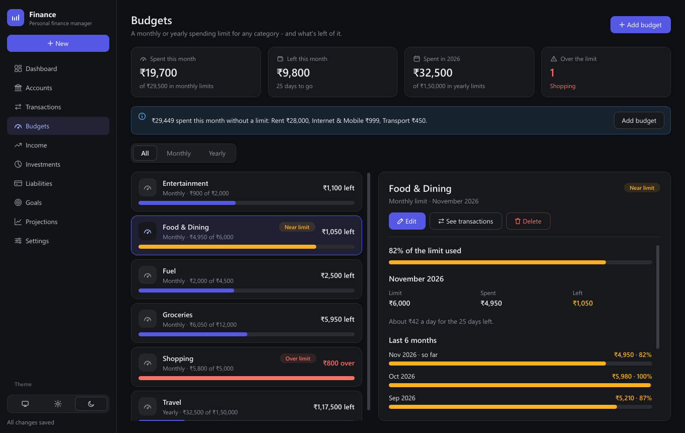

### What counts

- Only **expenses** in that category during the period. Transfers, investments
  and balance adjustments never count.
- Spending from an account in another currency counts once you add an exchange
  rate in Settings. Until then the page tells you what was left out.
- Budgets that are over or near their limit also appear under *Needs
  attention* on the Dashboard.

### Calendar year or financial year

A yearly limit runs January to December by default. To follow the Indian
financial year (April to March), change it in *Settings → Budgets*. Monthly
limits always follow the calendar month.

## 7. Income

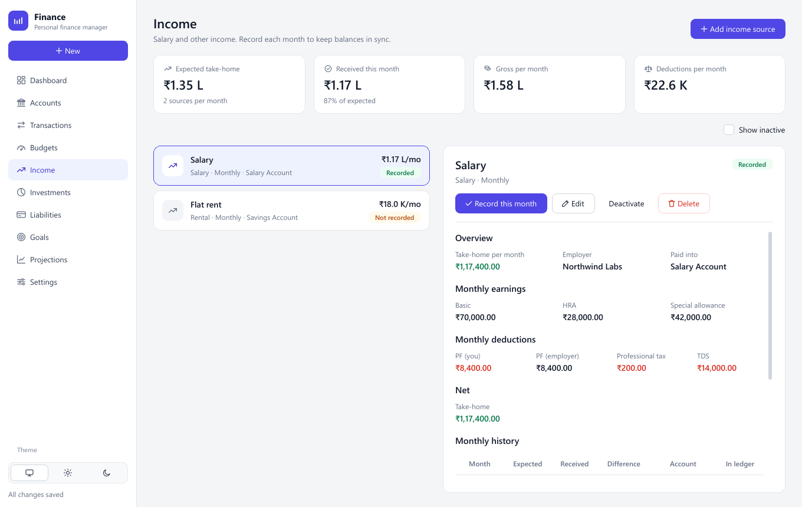

- **Add income source.** For a salary you can enter basic pay, HRA, special
  allowance and deductions (PF, professional tax, TDS), and the app works out
  your take-home pay. Other sources (rent, freelance work, dividends, interest)
  just need an expected amount and how often it arrives.
- **Record this month.** Enter what actually arrived and which account it went
  into. That account's balance goes up, and the month appears in the history
  table with the expected amount alongside.
- The Dashboard reminds you about monthly income you haven't recorded yet.

## 8. Investments

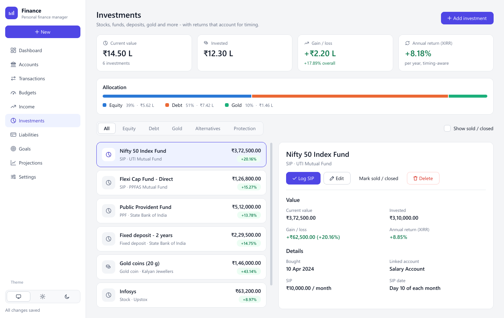

Mutual funds and SIPs, stocks, ETFs, fixed deposits, PPF, EPF, NPS, bonds, gold,
crypto, real estate, and term insurance.

- **Allocation** shows how your money is split between equity, debt, gold and
  other assets.
- **Annual return (XIRR)** takes into account *when* you put money in, so a
  fund you've been adding to monthly is judged fairly. It appears once an
  investment has 90 days of history.
- **Log SIP** records this month's instalment: the money leaves your account
  and the investment's invested amount and value go up.
- **Stock symbols.** Type a symbol such as `INFY` and its market cap and sector
  are filled in for you (for the stocks in the bundled list).
- **Term insurance** is listed under *Protection* and never counts as an
  investment, so it doesn't distort your returns.
- The app never goes online, so to update an investment's current value, use
  *Edit* and type in the new figure.

## 9. Liabilities

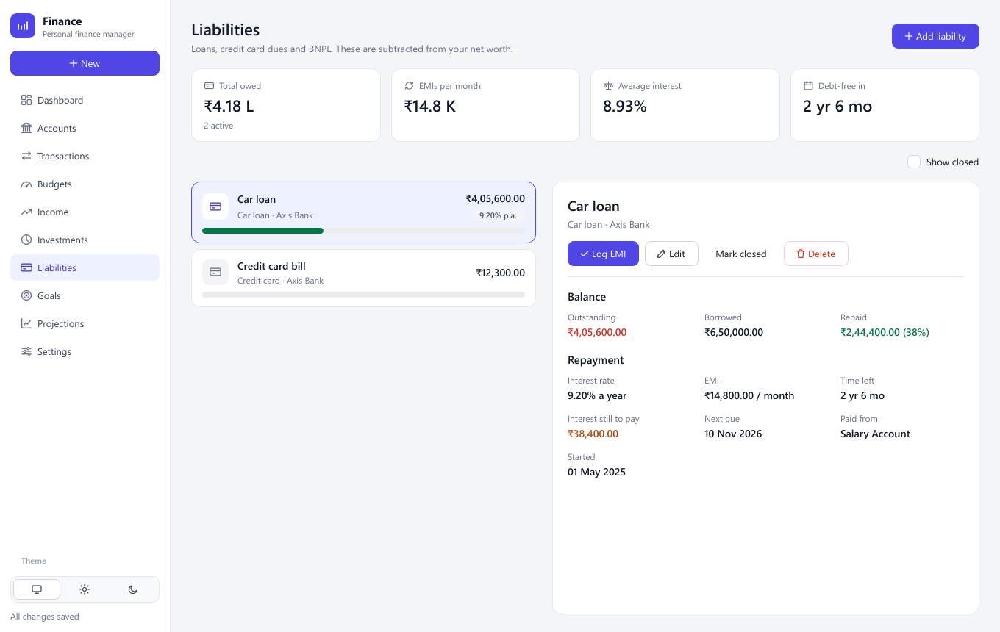

Loans, credit card dues and buy-now-pay-later. What you owe is subtracted from
your net worth.

- **Log EMI.** Records the payment from your account, reduces what you owe by
  the principal part, and moves the next due date on a month. The same form
  logs SIPs and insurance premiums from the Dashboard.

  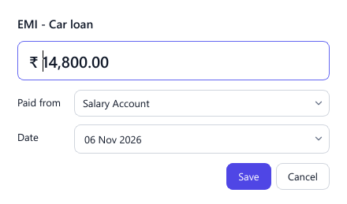

- **Debt-free in** and **Interest still to pay** come from the interest rate,
  EMI and months left.
- **Mark closed** once a loan is repaid. It stays in your history.

## 10. Goals

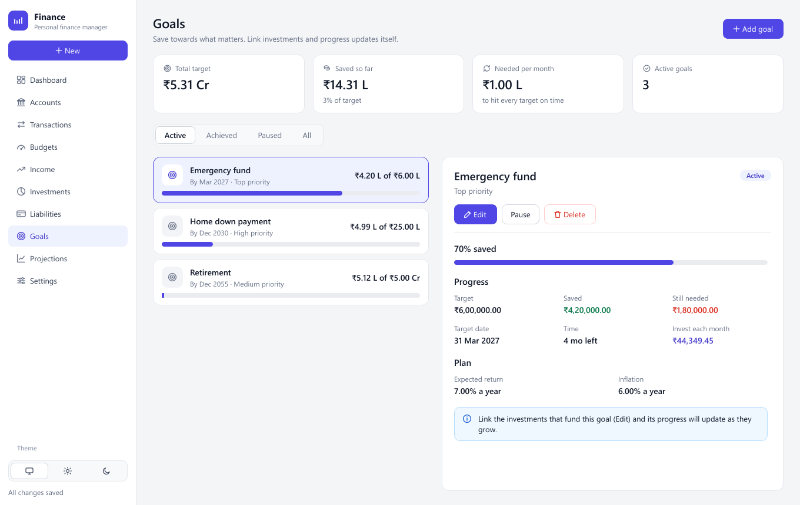

- Give each goal a **target** and a **date**: an emergency fund, a home down
  payment, children's education, retirement.
- **Link the investments** that fund it (*Edit*), and its progress updates as
  they grow.
- **Invest each month** is what it would take to reach the target on time at
  the goal's expected return, allowing for inflation.
- **Pause** a goal you've put on hold.

## 11. Projections

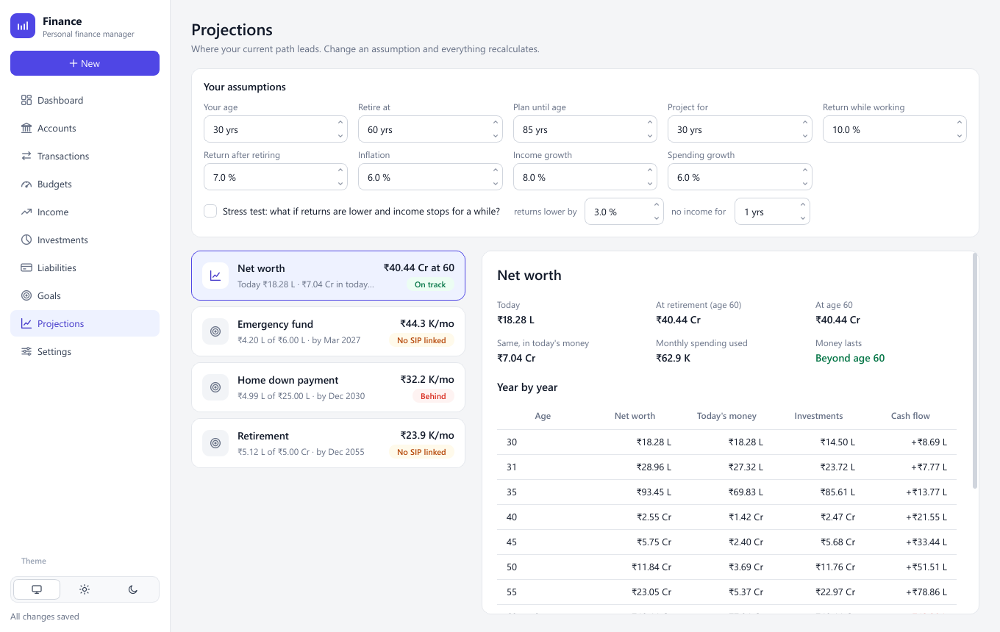

Where your current path leads, year by year.

- **Your assumptions** (age, retirement age, returns, inflation, income and
  spending growth) are remembered between sessions. Change one and everything
  recalculates.
- After retirement your spending is paid from your savings. If the money would
  run out, the page tells you at what age.
- **Stress test.** See what lower returns and a gap with no income would do.
- Each goal is checked against its target date.
- Projections use the last six months of spending you logged. If you haven't
  logged much, they will look better than reality, and the page warns you.

## 12. Settings

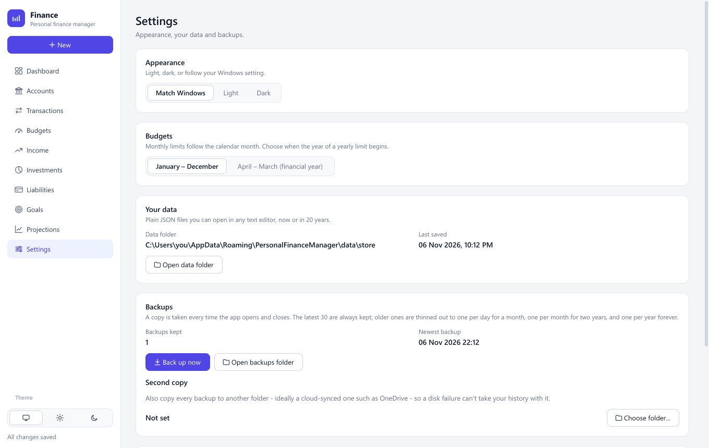

- **Appearance.** *Match Windows*, *Light* or *Dark*.
- **Budgets.** Whether yearly limits run January to December or April to March.
- **Your data.** Where your files are, with a button to open the folder.
- **Backups.** *Back up now*, and *Second copy*, which also copies every backup
  to another folder, ideally one synced to the cloud such as OneDrive.
- **Exchange rates.** For accounts in other currencies. Without a rate, those
  balances are left out of your totals, never added as if they were rupees.

## 13. Your data and backups

**Where it lives.**

| How you run the app | Data folder |
|---------------------|-------------|
| `run.bat` (from the source folder) | `data\` inside the app's folder |
| The built `.exe` | `%APPDATA%\PersonalFinanceManager\data\` |
| Either, with the `PFM_HOME` environment variable set | `%PFM_HOME%\data\` |

**What it looks like.** `data\store\` holds one plain JSON file per kind of
record: `accounts.json`, `transactions.json`, `budgets.json` and so on. Any text
editor can open them.

**Saving is safe.** Each save writes a new file and then swaps it in, so a crash
or power cut can't leave a half-written file. If a file is ever damaged, the app
won't start rather than overwrite it, and tells you which file is damaged and
where your newest backup is.

**Backups happen on their own.** A copy is made every time the app opens and
closes, and whenever you press *Back up now*. They go in `data\user\backups\`,
one folder per backup. The latest 30 are always kept. Older ones are thinned
out to one per day for a month, one per month for two years, and one per year
forever. Backups you make yourself, and the ones taken before an upgrade, are
never deleted.

**Restoring a backup:**

1. Close the app.
2. Open the backup folder you want (the name is its date and time).
3. Copy its files into `data\store\`, replacing the ones there.
4. Start the app.

**Checking your data.** This reads your files and reports anything odd, such
as a balance that doesn't match its transactions, a record pointing at
something that no longer exists, a missing exchange rate, or a budget the app
can't use. It never changes anything:

```bat
.venv\Scripts\python docs\skills\data-hygiene\check_store.py
```

**Privacy.** The app has no internet access, no accounts and no tracking.
Nothing leaves your computer unless you copy it somewhere yourself.

## 14. Keyboard shortcuts

| Keys | Does |
|------|------|
| **Ctrl+N** | Add an expense, from any page |
| **Ctrl+1** … **Ctrl+9**, **Ctrl+0** | Go to a page, in sidebar order (Ctrl+0 is Settings) |
| **F5** | Refresh the page you're on |
| **Enter** / **Delete** | Edit / delete the selected transaction |
| Double-click | Edit the selected item in a list |

## 15. When something looks wrong

| You see | What to do |
|---------|------------|
| *Personal Finance Manager is already open* | Only one copy runs at a time, because two would overwrite each other's changes. Look for the open window on the taskbar. |
| *Something went wrong, so that last action didn't finish* | The app hit an unexpected problem and kept running. Everything saved before it is safe. If something looks wrong, close and reopen the app. The message names the log file that holds the details. |
| *Your data file "…" is not valid JSON* (or similar) at start-up | Nothing has been changed. Restore that one file from your newest backup (see [Restoring a backup](#13-your-data-and-backups)) and start again. |
| *The balance doesn't match its transactions* | Open the account and press **Reconcile**. |
| Balances or spending in another currency are missing from totals | Add an exchange rate in **Settings → Exchange rates**. |
| A budget looks too low or too high | Click **Edit** on it. The form shows your recent spending in that category. |
| Projections look too good | Log your expenses for a few months. Projections use your actual recent spending. |
